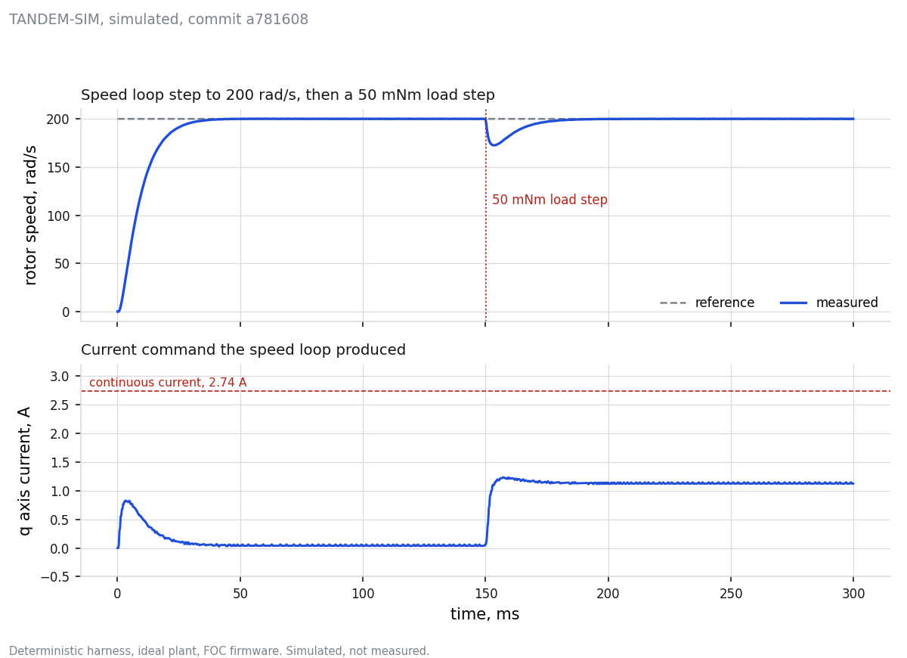

# TANDEM-SIM

A switching level digital twin of a haptic robot joint, with field oriented
control firmware running inside it unmodified. No hardware, no cloud, one
machine.

**Status: day 2 of 7. One motor is closed loop in current and in speed.** There
is no switching model, no load and no second joint yet, so this is a single
drive on an ideal plant, not a twin. Every number in this repository is
simulated, and the figures say so on their face.



## What exists

| Path | What it is |
|---|---|
| `firmware/` | C11. Clarke, Park, space vector modulation, a PI current loop at 20 kHz, a PI speed loop at 2 kHz, a command filter, boot offset calibration. Includes only its own headers, `hal.h` and three standard headers. Links no libm. |
| `firmware_portable` | Compile only target, `-ffreestanding -Werror -Wdouble-promotion`, 6991 bytes of `.text` and `.data` against a 16384 byte budget. |
| `sim/` | C++20. Ideal plant: phase resistance and inductance, back EMF, rotor inertia, viscous friction, 1 MHz step with energy accounting. A rotor clamp and a configurable step size exist for measurement and convergence studies. |
| `harness/` | C++20. The only thing that owns time. One control window function shared by the harness and the closed loop tests: duty at the window start, half window, ADC latch at the window centre, half window, firmware tick. Two scenarios, `speed_step` and `current_step`. |
| `tests/` | In repo assert framework, six ctest entries: plant and convergence, transforms and firmware, closed loop against the plant, deterministic repeat, firmware boundary, size budget. |
| `tools/` | Boundary check, size check, determinism check, the day 2 plot, and an independent discrete model of the current loop. |
| `docs/` | `spec.md` (plan and decisions), `parameters.md` (every constant cited or marked ASSUMED), `results.md` (numbers with methods and commits), `bringup-log.md`, `model-limits.md`, `validation-plan.md`, `figures/`. |

## The numbers, briefly

| Quantity | Value | Source |
|---|---|---|
| current loop, 10 to 90 percent rise, 2 A step | 222 us | `docs/results.md`, commit a781608 |
| same loop in an independent discrete model | 222 us, 0.1 percent away | `tools/reference_current_loop.py` |
| speed loop, 0 to 200 rad/s, 10 to 90 percent | 17.0 ms | `docs/results.md` |
| speed dip on a 50 mNm load step | 13.7 percent, back inside 2 percent in 22 ms | `docs/results.md` |
| plant integration error at 1 us | 1.8e-5 relative, halves with the step | `docs/results.md` |

None of these is a measurement. They are predictions from a model whose limits
are written down in `docs/model-limits.md`, and the speed figure in particular is
a property of the bare rotor, not of the joint.

## Build

Three commands on a fresh clone:

```sh
cmake --preset dev
cmake --build --preset dev -j
ctest --preset dev --output-on-failure
```

Sanitizers:

```sh
cmake --preset asan
cmake --build --preset asan -j
ctest --preset asan --output-on-failure
```

Requirements: a C11 and C++20 compiler, CMake 3.22 or newer, Ninja, and Python
3 for the size check. The plotting tool additionally wants numpy and matplotlib
(`requirements.txt`).

To reproduce the day 2 figures:

```sh
./build/dev/harness/tsim_harness --scenario current_step
./build/dev/harness/tsim_harness --scenario speed_step
python3 tools/plot_day2.py --commit "$(git rev-parse --short HEAD)"
python3 tools/reference_current_loop.py
```

## Portability

`firmware/` may include its own headers, `hal.h` and three standard headers,
nothing else. A board adds `hal_stm32.c` and changes no firmware source. The
host simulator implements the same header. `tools/check_firmware_boundary.sh`
fails the build if a source file includes anything outside that rule, or if a
compiled object references a symbol outside `hal_*` and the compiler runtime.
The rule is checked, not promised, and it has been proved to fail on purpose.

## Determinism

The harness reads no clock and schedules on integer nanoseconds, so two runs of
the same binary with the same flags produce byte identical output. That is a
test (`deterministic_repeat`), not a claim. Cross compiler bit identity is a
different and much stronger statement, and it is not made.

## Honesty

Every constant in this repo is either cited in `docs/parameters.md` or marked
ASSUMED there. Every figure is labelled simulated and stamped with the commit
that produced it. No simulated number is presented as measured. Where the model
does not capture something, `docs/model-limits.md` says so, and each day ends
with a note on what was cut.
