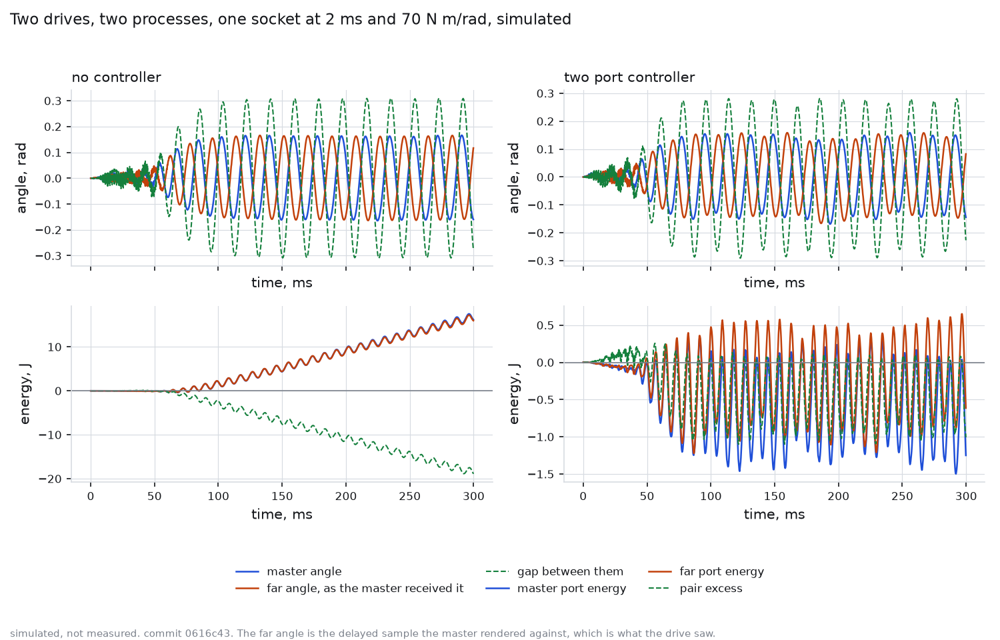
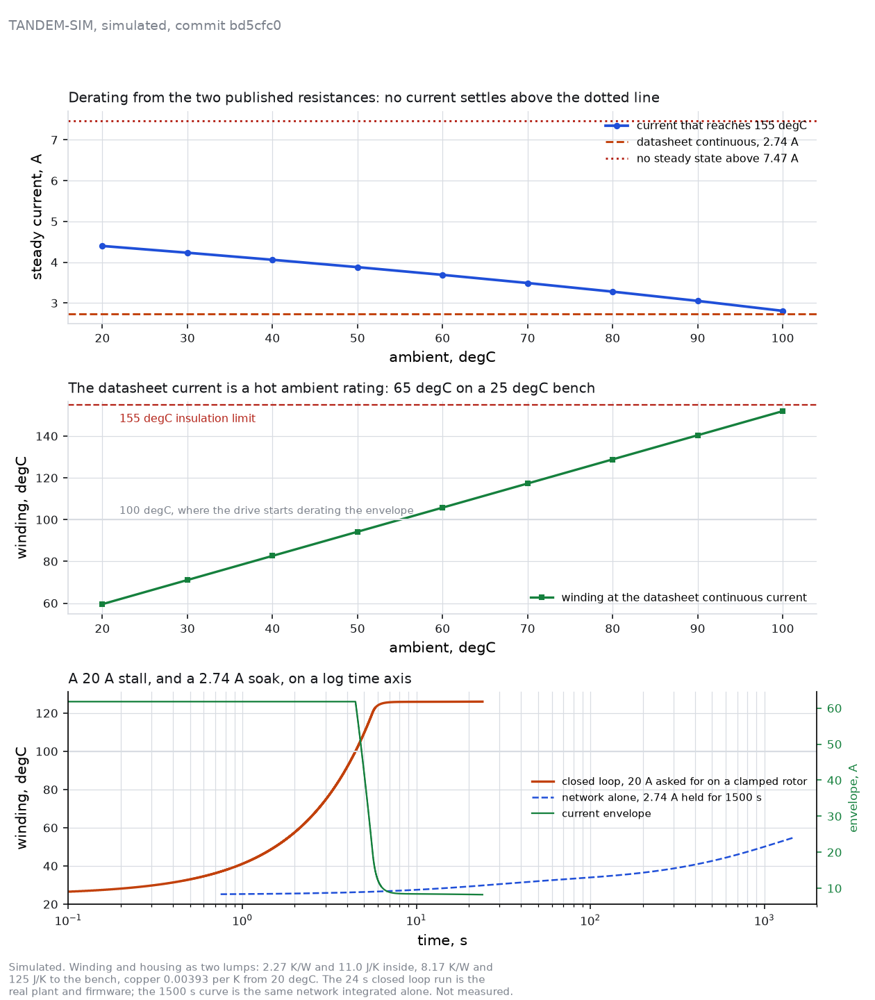
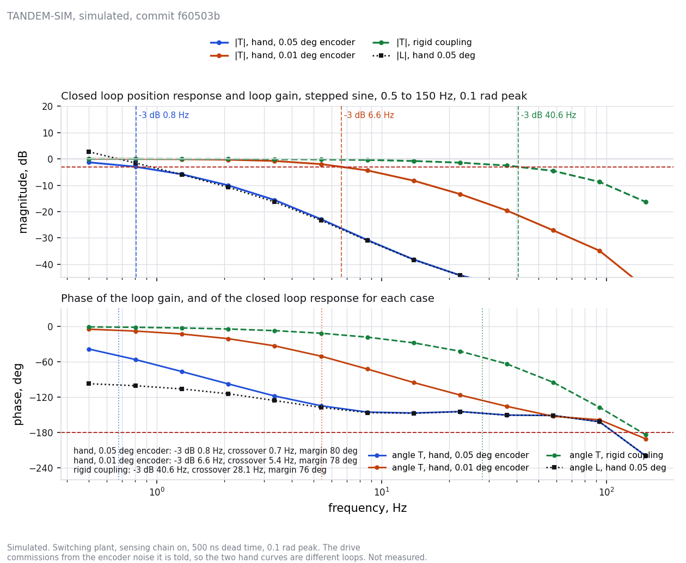

# TANDEM-SIM

A switching level digital twin of a haptic robot joint, with field oriented
control firmware running inside it unmodified. No hardware, no cloud, one
machine.

**Status: day 6 of 7. Two drives, two processes and one real socket.** Each side
is its own program: the same unmodified FOC firmware, its own plant, its own
encoder noise, its own bridge, talking to the other over UDP on loopback in 40
byte packets once per control window. The firmware is unchanged from day 5 apart
from a setter that hands it the far end's port energy, which is what makes a two
port passivity observer possible on a drive. The two processes are locked step
window by window instead of running on two clocks, which is the day's largest cut
and is written down. Every number in this repository is simulated, and the
figures say so on their face.



Two joints over a link do not fail the way one joint does. One joint rings up
until the current limit holds it; a pair separates, because each drive renders a
spring to an angle a few milliseconds old and both of them rail against the hands
they are bolted to. At 8 ms and 40 N m/rad the two joints end 0.696 rad apart from
a 2 mrad release, three hundred and fifty times the disturbance that started it.
A passivity controller on both ends takes that to 0.11 rad, a factor of six, and
changes nothing above 70 N m/rad where the motor rather than the link sets the
gap. The two port observer the day was built for is within a few percent of the
one port controller everywhere and worse by up to 17 percent at the longest delay,
which is this day's honest negative and it is explained in the results: a
symmetric pair has almost no energy that crosses one port without crossing the
other, so there is nothing for the extra instrument to see.



A stall is a duration now, not a torque. A 20 A stall on a clamped rotor from a
25 degC bench puts the winding through 100 degC in 4.4 s and through the 155 degC
insulation limit in 7.4 s, while the housing is still at 56 degC. The firmware
derates its own stall envelope from 100 degC down to a 130 degC trip, and a 24 s
run of the closed loop asked for 20 A and settled at 126 degC and 8.2 A without
latching a fault, because a proportional derating finds its own equilibrium
below the trip.



The same handle, the same shaft and the same gains rule, measured twice: the
position loop closes at 0.81 Hz with the 0.05 deg encoder the parameter table
assumed and at 6.62 Hz with a 0.01 deg one. The drive derates its own crossover
to where the velocity noise alone would command a tenth of continuous current,
so the encoder is what limits this joint and not the mechanics: the anti
resonance would allow 322.7 rad/s and the sensor allows 33.6.

## What exists

| Path | What it is |
|---|---|
| `firmware/` | C11. Clarke, Park, space vector modulation, a PI current loop at 20 kHz, a PI speed loop at 2 kHz, a position cascade at 1 kHz, a 20 kHz impedance mode, d/q decoupling and back EMF feedforward, gate dead time compensation, self commissioning from the board config, boot offset calibration. Includes only its own headers, `hal.h` and three standard headers. Links no libm. |
| `firmware_portable` | Compile only target, `-ffreestanding -Werror -Wdouble-promotion`, 8271 bytes of `.text` and `.data` against a 16384 byte budget. |
| `sim/` | C++20. One `MechanicalSystem` (two masses, a torsion spring, backlash, Coulomb and viscous friction, a hand, a wall, and an energy account) shared by two plants. `IdealPlant` is the average voltage source of day 1 and 2. `SwitchingPlant` resolves the carrier at 1 us, signs the dead time error by phase current, puts one device of on resistance in each leg, counts transition energy and integrates a 100 uF link with ESR behind a source resistance. A test asserts the second reduces to the first, and another asserts the rigid mechanics reproduce the day 1 body bit for bit. |
| `harness/` | C++20. The only thing that owns time. One control window function shared by the harness and the closed loop tests. Six scenarios (`speed_step`, `current_step`, `dead_time`, `swept_sine`, `wall_contact`, `backlash`) with switches for plant, load, mode, coupling, dead time, compensation, encoder noise and sensing chain, plus `tsim_sample_probe`, which holds a duty and records one switching period at 1 us. |
| `tests/` | In repo assert framework, 46 cases in 6 ctest entries: plant and convergence, mechanics, inverter physics, transforms and firmware, closed loop and sensing, and one entry for determinism, the firmware boundary and the size budget. |
| `tools/` | Boundary check, size check, determinism check, the day 2, 3 and 4 plots, a THD analyser, a stepped sine frequency response fit, and an independent discrete model of the current loop. |
| `docs/` | `spec.md` (plan and decisions), `parameters.md` (every constant cited or marked ASSUMED), `results.md` (numbers with methods and commits), `bringup-log.md`, `model-limits.md`, `validation-plan.md`, `figures/`. |

## The numbers, briefly

| Quantity | Value | Source |
|---|---|---|
| dead time distortion, 500 ns, 1.96 A, 30 rad/s | 1.66 percent, 29.7 mA of fifth harmonic | `docs/results.md`, commit 41433a1 |
| same, with compensation | 0.27 percent, 1.7 mA | `docs/results.md` |
| same, sensing chain on | 2.09 percent, and 1.13 percent compensated | encoder floor, see results |
| sampling at the window centre, 20 A | 1.1 mA from the period mean | `docs/results.md` |
| sampling at a switching edge | 224 mA off, 1.1 percent of 20 A | `docs/results.md` |
| speed dip on a 50 mNm load step, switching plant | 15.8 percent, against 14.9 on the average plant | `docs/results.md` |
| transition loss at 1.96 A | 0.27 W from an assumed 50 ns crossover | `docs/results.md` |
| position loop -3 dB, hand, 0.05 deg encoder | 0.81 Hz, 80 deg of phase margin | `docs/results.md` |
| same joint, 0.01 deg encoder | 6.62 Hz, 78 deg | `docs/results.md` |
| same joint, rigid coupling | 40.6 Hz, 76 deg | `docs/results.md` |
| rendered stiffness, 1 N m/rad commanded | 0.634 N m/rad at the handle, 63 percent | `docs/results.md` |
| backlash, 1 degree | zero torque inside 8.73 mrad either side | `docs/results.md` |
| current loop, 10 to 90 percent rise, 2 A step | 222 us | `docs/results.md`, commit a781608 |
| plant integration error at 1 us | 1.8e-5 relative, halves with the step | `docs/results.md` |

None of these is a measurement. They are predictions from a model whose limits
are written down in `docs/model-limits.md`, and the speed numbers in particular
are a property of the bare rotor, not of the joint.

## Build

Three commands on a fresh clone:

```sh
cmake --preset dev
cmake --build --preset dev -j
ctest --preset dev --output-on-failure
```

Sanitizers:

```sh
cmake --preset asan
cmake --build --preset asan -j
ctest --preset asan --output-on-failure
```

Requirements: a C11 and C++20 compiler, CMake 3.22 or newer, Ninja, and Python
3 for the size check. The plotting tool additionally wants numpy and matplotlib
(`requirements.txt`).

To reproduce the day 5 figures, `python3 tools/plot_day5.py --commit <sha>`
after the runs listed in `docs/results.md`.

To reproduce the day 4 figures:

```sh
./build/dev/harness/tsim_harness --scenario swept_sine --log-every 5 \
  --out data/run_latest/day4_sweep.csv
./build/dev/harness/tsim_harness --scenario swept_sine --encoder-noise-deg 0.01 --log-every 5 \
  --out data/run_latest/day4_sweep_quiet.csv
./build/dev/harness/tsim_harness --scenario swept_sine --load rigid --log-every 5 \
  --out data/run_latest/day4_sweep_rigid.csv
./build/dev/harness/tsim_harness --scenario wall_contact --out data/run_latest/day4_wall_stiff1.csv
./build/dev/harness/tsim_harness --scenario wall_contact --stiffness 4 \
  --out data/run_latest/day4_wall_stiff4.csv
./build/dev/harness/tsim_harness --scenario backlash --encoder-noise-deg 0.01 \
  --out data/run_latest/day4_backlash_0.csv
./build/dev/harness/tsim_harness --scenario backlash --encoder-noise-deg 0.01 --backlash-deg 1 \
  --out data/run_latest/day4_backlash_1deg.csv
python3 tools/plot_day4.py --commit "$(git rev-parse --short HEAD)"
```

To reproduce the day 3 figures:

```sh
./build/dev/harness/tsim_harness --scenario dead_time --dead-time-ns 0 --compensation off \
  --out data/run_latest/day3_dead_time_none.csv
./build/dev/harness/tsim_harness --scenario dead_time --compensation off
./build/dev/harness/tsim_harness --scenario dead_time --compensation on \
  --out data/run_latest/day3_dead_time_compensated.csv
./build/dev/harness/tsim_sample_probe
python3 tools/plot_day3.py --commit "$(git rev-parse --short HEAD)"
```

The harness defaults to the switching plant and to the sensing chain on, which
is the honest configuration. `--plant ideal --imperfections off` reproduces the
day 2 plant, though the day 2 control path is at commit a781608 and not at HEAD.

## Portability

`firmware/` may include its own headers, `hal.h` and three standard headers,
nothing else. A board adds `hal_stm32.c` and changes no firmware source: the
motor's inductance, its flux linkage and the gate dead time all arrive through
`hal_board_config`, because a drive that decouples and compensates has to know
them. The host simulator implements the same header.
`tools/check_firmware_boundary.sh` fails the build if a source file includes
anything outside that rule, or if a compiled object references a symbol outside
`hal_*` and the compiler runtime. The rule is checked, not promised, and it has
been proved to fail on purpose.

## Determinism

The harness reads no clock and schedules on integer nanoseconds, so two runs of
the same binary with the same flags produce byte identical output. That is a
test (`deterministic_repeat`), not a claim, and it covers the sensing chain's
noise too, because the generator is a seeded xorshift in the HAL and not
`rand()`. Cross compiler bit identity is a different and much stronger
statement, and it is not made.

## Honesty

Every constant in this repo is either cited in `docs/parameters.md` or marked
ASSUMED there. Every figure is labelled simulated and stamped with the commit
that produced it. No simulated number is presented as measured. Where the model
does not capture something, `docs/model-limits.md` says so, and each day ends
with a note on what was cut. Two parameters have been corrected rather than
defended: the switching loss on day 3, which had been recorded in a form that
could not scale with current, and the coupling stiffness on day 4, which had
been 0.9 N m/rad since day 1 with no arithmetic behind it and was capping the
position loop at 3 Hz. The bring-up log has both entries. A number that was
assumed and turns out to be the reason a result is bad is the most useful thing
this repository can find, and finding it late is the cost of assuming early.
