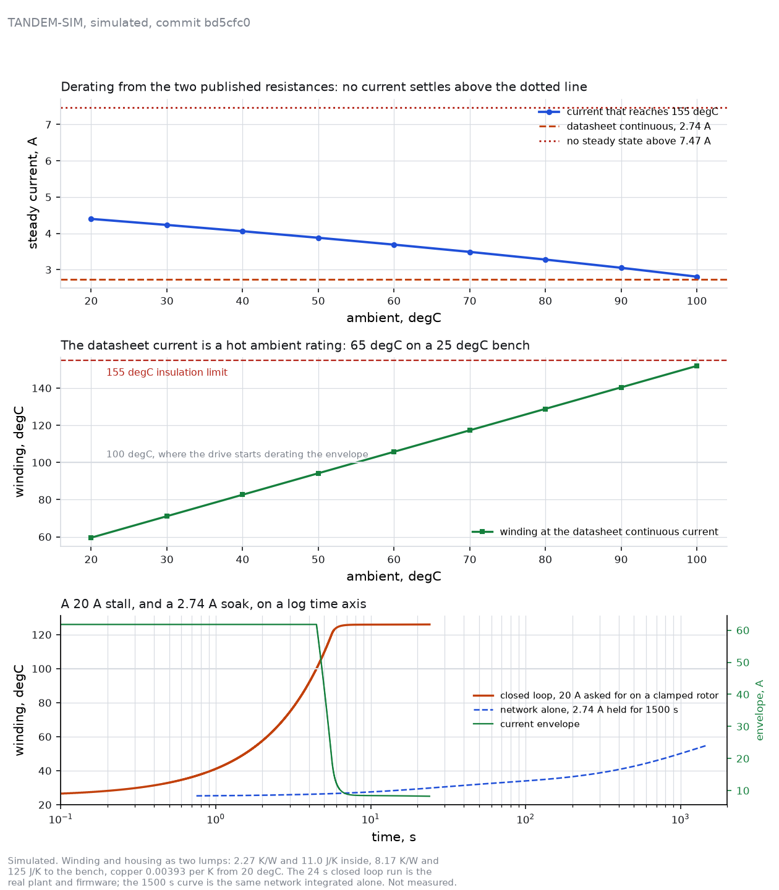
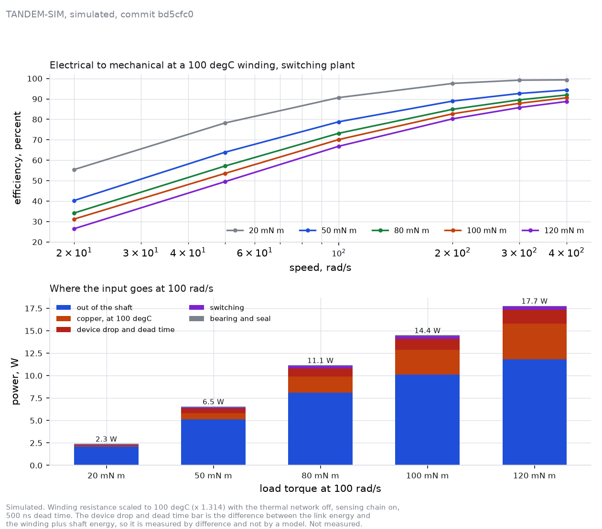
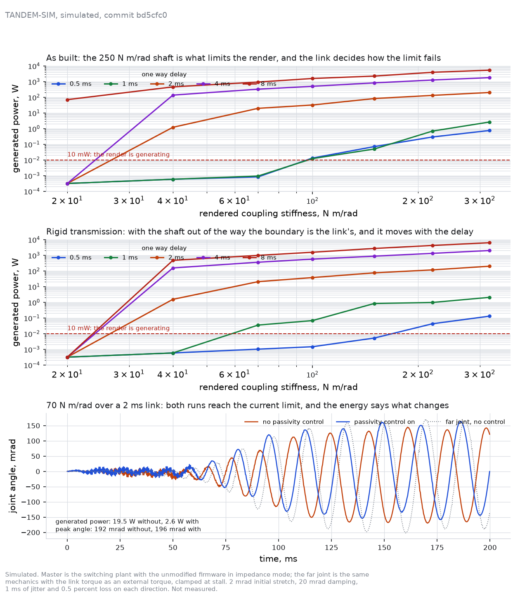
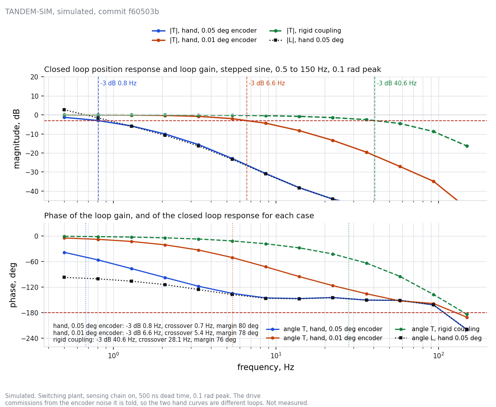
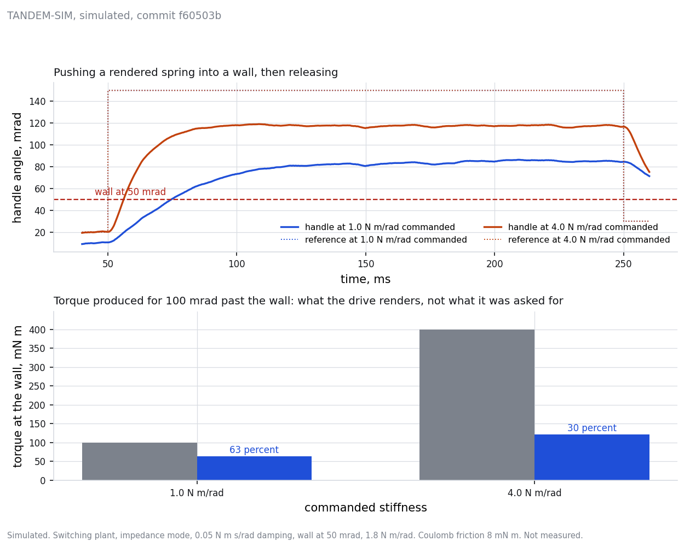
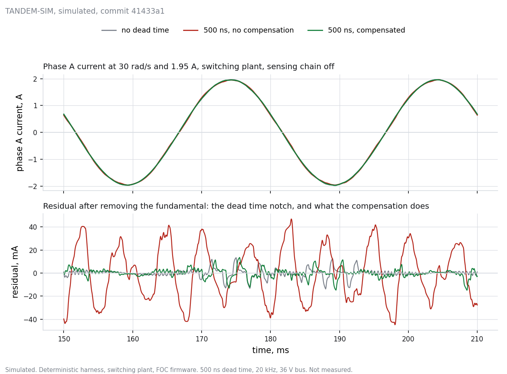
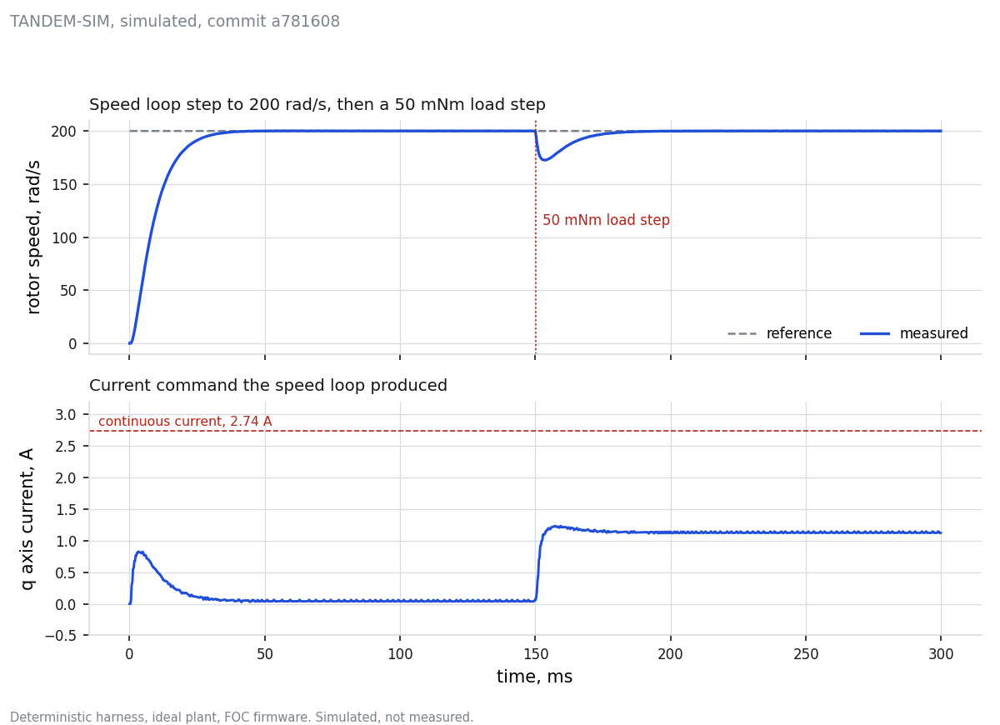

# Results

A spec sheet of simulated numbers, each with its method and the commit that
produced it. No measured number appears in this file, because nothing has been
measured. Every row can be regenerated from the commit beside it.

Status: day 5 of 7. One motor driving a two mass joint through a steel shaft
with backlash, with a hand and a wall on the far side, in position and in
impedance, now with a winding that heats and a second joint over a link that
arrives late and sometimes does not arrive. The firmware derates its own stall
envelope with temperature, latches a fault above 130 degC, and runs a passivity
observer in impedance mode.

## Day 5 results

Three questions: how long a stall is, what the drive converts at a stated
winding temperature, and where two joints over a delayed link stop being a
passive pair.



### The thermal network, and what a stall is worth

Two nodes, published values: 2.27 K/W and 11.0 J/K from winding to housing,
8.17 K/W and 125 J/K from housing to the bench, the heat capacities being the
datasheet's 24.9 s and 1020 s thermal time constants times those resistances.
Copper loss is `1.5 I^2 R`, not `3 I^2 R`, because three sinusoids of peak `I`
sum to a mean square of `1.5 I^2`; the day 5 loss number was wrong by a factor
of two in the first cut and the bring-up log has it.

| Ambient, degC | Steady current that reaches 155 degC |
|---|---|
| 20 | 4.400 A |
| 30 | 4.233 A |
| 40 | 4.061 A |
| 50 | 3.880 A |
| 60 | 3.691 A |
| 70 | 3.491 A |
| 80 | 3.279 A |
| 90 | 3.053 A |
| 100 | 2.808 A |

Above 7.472 A no steady state exists at any ambient: copper resistance rises
0.393 percent per kelvin, the loss rises with it, and past that current the loss
grows faster than the temperature difference can carry it away. That is a
property of the two published resistances and not a policy, and it is the number
that makes a stall a duration rather than a torque.

The datasheet continuous current turns out to be a hot ambient rating rather
than a conservative one. Held at 2.74 A on a 25 degC bench the winding settles
at 65.3 degC, which is 90 K of headroom, and the same current only reaches the
insulation limit at 102.6 degC ambient, above the 100 degC the motor is rated
for. At 100 degC ambient it runs at 152.0 degC. The rating is honest, and the
derating curve above is what the drive would need to respect it.

A 20 A stall on a clamped rotor, network alone, from 25 degC:

| Quantity | Value |
|---|---|
| winding reaches 100 degC | 4.410 s |
| winding reaches 155 degC | 7.390 s |
| winding at 30 s | 730.6 degC |
| housing at 30 s | 56.5 degC |

The gap between the last two rows is the point of a second node. The housing is
still cold when the winding is glowing, so a drive that measures the housing
would see nothing wrong, and the difference between a one node and a two node
model here is the difference between a plausible graph and the right one.

The same stall in the closed loop, real firmware, 24 s of it:

| Quantity | Value |
|---|---|
| winding, final | 126.0 degC |
| current envelope, final | 8.236 A |
| electrical energy drawn | 2243.7 J |
| of which copper | 2009.7 J (89.6 percent) |
| switching | 38.3 J |
| faults latched | none |

The drive was asked for 20 A and ended at 8.2 A, because the envelope is linear
from the 61.8 A stall at 100 degC down to zero at 130 degC, and at 126 degC that
leaves 8.2. It settles there and does not latch: the policy is a proportional
regulator and it finds its own equilibrium below the trip. The trip is a
backstop for a sensor that is slow or a winding that is already hot at boot, and
it is covered by a firmware test that puts the stub HAL at 131 degC, not by this
run. Saying that plainly matters, because "the drive protected itself" would be
a weaker claim than the one the run supports.

### Efficiency at a stated winding temperature



Winding resistance scaled to 100 degC, `0.291 ohm x 1.3144 = 0.3825 ohm`, the
thermal network off, sensing chain on, 500 ns dead time, switching plant. This
is a map at a stated temperature and not a soak, and the figure says so.

| Load torque | Efficiency at 20 rad/s | Best, at 400 rad/s |
|---|---|---|
| 20 mN m | 55.4 percent | 99.3 percent |
| 50 mN m | 40.3 percent | 94.4 percent |
| 80 mN m | 34.2 percent | 91.9 percent |
| 100 mN m | 31.2 percent | 90.5 percent |
| 120 mN m | 26.5 percent | 88.7 percent |

The map runs from 26 to 99 percent and the shape is not the one a datasheet
draws, because the losses are not a single term. At 100 rad/s and 120 mN m the
input is 17.7 W, of which 11.9 W reaches the shaft, 3.3 W is copper, 1.7 W is
device drop and dead time, and the rest is switching and the bearing. At
20 mN m the copper is 0.11 W and the dead time and device drop are 0.15 W, so
above a tenth of a newton metre the inverter is the largest loss and the winding
is a rounding error.

The unaccounted term, meaning everything the link delivered that did not reach
the winding or the shaft, is +0.15 to +1.70 W across the low speed column and
-0.19 W at 400 rad/s and 20 mN m. The negative value is the model
over-accounting at high speed and low torque, which is honest to publish: the
dead time error is 0.36 V per leg at 36 V and 20 kHz, and at 2.18 A that is
1.6 W if both legs are wrong, against 1.40 W measured at 100 rad/s and 100 mN m.

### Two joints over a link that arrives late



Master is the switching plant with the unmodified firmware in impedance mode,
the far joint is the same mechanics with the bridge open and the link torque as
an external torque, clamped at stall. 20 mrad of initial stretch, 20 mN m s/rad
of damping, 1 ms of jitter and 0.5 percent loss each way. Generated power is
`-min(excess) / 0.5 s` from the passivity observer in the firmware, so it is the
render's own measurement of what it returned to the user, not a model of it.

Rendered stiffness against one way delay, generated power in watts, 250 N m/rad
shaft, controller off:

| Stiffness | 0.5 ms | 1 ms | 2 ms | 4 ms | 8 ms |
|---|---|---|---|---|---|
| 20 N m/rad | 0.0003 | 0.0003 | 0.0003 | 0.0003 | 70.6 |
| 40 | 0.0006 | 0.0006 | 1.21 | 137 | 459 |
| 70 | 0.0008 | 0.0009 | 19.7 | 329 | 938 |
| 100 | 0.0133 | 0.0122 | 32.1 | 500 | 1580 |
| 150 | 0.0713 | 0.0499 | 82.9 | 829 | 2250 |
| 220 | 0.293 | 0.697 | 132 | 1260 | 3910 |
| 320 | 0.761 | 2.64 | 202 | 1780 | 5350 |

Taking 10 mW as the line where a render is generating rather than just noisy,
the boundary sits at 100 N m/rad for 0.5 and 1 ms, at 70 for 2 ms, at 40 for
4 ms, and at 20 for 8 ms. Above the line it is not marginal: at 2 ms and
70 N m/rad the render returns 19.7 W to a user who is trying to feel a wall.

With a rigid transmission the boundary at half a millisecond moves out to
220 N m/rad and at one millisecond to 70, because a stiff shaft puts the joint's
own resonance high enough that the delay has less to push against. But the
flexible joint is not simply worse: at 8 ms and 20 N m/rad it generates 70.6 W
where the rigid one generates 0.3 mW. The shaft adds a second resonance and the
delay can walk one of them up. That reversal is reported and not explained,
because explaining it would take a two port analysis that is day 6 work.

The passivity controller, at 2 ms and 70 N m/rad:

| Case | Generated, controller off | On |
|---|---|---|
| 2 ms, 70 N m/rad | 19.7 W | 2.74 W |
| 2 ms, 100 N m/rad | 32.1 W | 6.77 W |
| 4 ms, 40 N m/rad | 137 W | 48 W |
| 8 ms, 70 N m/rad | 938 W | 852 W |
| 8 ms, 20 N m/rad | 0.3 mW | 1.78 W |

So the controller takes a factor of seven to thirteen out of the generated power
in the regime where the loop is only just active, does essentially nothing once
the delay dominates, does not move any boundary in the grid, and at 8 ms with a
soft render it makes a passive pair active. This is the measured limitation of a
one port passivity observer, and it is the day's finding rather than a bug: a
controller that can only see the effort and flow at its own port can bound the
energy it returns, and cannot know that the thing it is coupled to is itself
delayed. Bounding returned energy is necessary and is not stability.

The first version of the controller was worse than limited, it was lying. It
asked for 290 N m from a 2.85 N m motor and then subtracted the energy as if the
torque had been delivered, so it reported itself passive to within 0.09 J while
the joint carried on at the current limit. The fix is that the correction is
clamped to stall torque and the observer is charged for the torque that was
actually applied, which is why the table above shows large numbers where the
earlier version showed small ones.

### What was cut, and the largest one

The far joint is mechanics, not firmware. `hal.h` is a contract with one MCU:
one set of phase currents, one encoder, one bridge. A second joint with its own
drive means a second process and a real network between them, which is day 6.
So the far side here is the same `IPlant` mechanics with the bridge open, driven
by link torque clamped at stall, and the bilateral result is about the master's
render and the link, not about two drives negotiating.

Also cut, in the order they matter: no two port passivity, no energy tank with a
refill path from something known to be passive, no packetisation or burst loss
(the link is a constant delay with jitter and independent per sample loss), no
magnet temperature so the torque constant does not drift, no dependence of the
convective resistance on speed, and no housing sensor, so the ambient is the
housing's boundary by construction.

## Reproduce day 5

```sh
cmake --preset dev
cmake --build --preset dev -j

# the derating curve and the two soaks
./build/dev/harness/tsim_thermal --derating
./build/dev/harness/tsim_thermal --soak --current 2.74 --seconds 1500 \
  --out data/run_latest/day5_soak_continuous.csv
./build/dev/harness/tsim_thermal --soak --current 20 --seconds 30

# the 20 A stall through the real firmware, 24 s
./build/dev/harness/tsim_harness --scenario thermal_soak --out data/run_latest/day5_thermal_soak.csv

# the efficiency map at a stated winding temperature
./build/dev/harness/tsim_efficiency

# the stability boundary, two transmissions, both controller states
./build/dev/harness/tsim_bilateral --shaft-stiffness 250 \
  --out data/run_latest/day5_stability_250.csv
./build/dev/harness/tsim_bilateral --shaft-stiffness 5000 \
  --out data/run_latest/day5_stability_rigid.csv

# the two traces in the bottom panel
./build/dev/harness/tsim_bilateral --stiffness-list 70 --delay-list 2 --shaft-stiffness 250 \
  --trace --trace-passivity off --trace-stiffness 70 --trace-delay-ms 2 \
  --trace-out data/run_latest/day5_bilateral_pc_off.csv
./build/dev/harness/tsim_bilateral --stiffness-list 70 --delay-list 2 --shaft-stiffness 250 \
  --trace --trace-passivity on --trace-stiffness 70 --trace-delay-ms 2 \
  --trace-out data/run_latest/day5_bilateral_pc_on.csv

python3 tools/plot_day5.py --commit "$(git rev-parse --short HEAD)"
```

## Day 4 results



Simulated, scenario `swept_sine`: hand attached (0.45 N m/rad spring, 0.02 N m
s/rad), 250 N m/rad steel coupling with 2e-3 N m s/rad of damping, 8 mN m of
Coulomb friction, switching plant, sensing chain on, 500 ns of dead time,
0.1 rad peak from 0.5 to 150 Hz in thirteen log spaced points. Two cycles to
settle, four to measure, and the measurement window is a column in the CSV so
the analysis cannot fit the settling. T is the complex amplitude of the joint
angle over the reference angle, both fitted at the frequency the harness
generated. L is T / S, where S = 1 - T is the sensitivity, so the phase margin
comes from the same run as the response and not from a model of the loop.

| Case | -3 dB | loop crossover | phase margin | gain margin |
|---|---|---|---|---|
| hand, 0.05 deg encoder noise | 0.81 Hz | 0.68 Hz | 80.3 deg | not reached in 150 Hz |
| hand, 0.01 deg encoder noise | 6.62 Hz | 5.42 Hz | 77.8 deg | not reached in 150 Hz |
| rigid coupling | 40.60 Hz | 28.13 Hz | 75.9 deg | not reached in 150 Hz |

The gain margin row says what happened rather than what was asked for: the
phase of the hand's loop gain flattens near -140 degrees and only reaches -180
above 150 Hz, so there is no crossing to read a margin off inside the swept
band. It is reported as not reached, not as infinite.

The two hand curves are the day's finding, and it is not a tuning result. The
drive commissions a speed crossover from two limits and takes the smaller:
a quarter of the joint's anti resonance (322.7 rad/s here, from 250 N m/rad over
a 1.5e-4 handle) and the crossover at which the velocity noise alone would
command a tenth of continuous current. The second limit depends only on the
encoder:

| Encoder noise | Velocity noise | Commissioned speed crossover | Position gain |
|---|---|---|---|
| 0.05 deg, 2.3 counts | 2.5 rad/s | 33.6 rad/s | 8.4 per second |
| 0.01 deg, 0.5 counts | 0.50 rad/s | 168 rad/s | 52.8 per second |
| none, rigid coupling | 0 | 322.7 rad/s | 80.6 per second |

So the same mechanics close at 0.8 Hz with the encoder the parameter table
assumed and at 6.6 Hz with one eight times quieter. The velocity estimate is a
ten tick difference, so its noise is sqrt(2) sigma / 0.5 ms, and the speed gain
the handle's inertia needs turns that into current: 2.5 rad/s times 1.06 A per
rad/s is 2.7 A, which is the continuous rating. The first version of this day
had a loop that railed at +-2.74 A and swung the load at +-20 rad/s, and that
was the sensor, not the tuning.



Simulated, scenario `wall_contact`: a rendered spring of 1.0 and then 4.0 N m/rad
pushing to 0.15 rad against a wall at 0.05 rad with 1.8 N m/rad of its own, 0.05
N m s/rad of rendered damping, impedance mode at 20 kHz.

| Commanded | Rendered at the handle | Torque for 100 mrad past the wall | Ratio | Series prediction |
|---|---|---|---|---|
| 1.0 N m/rad | 0.634 N m/rad | 63.4 mN m | 0.63 | 0.640 |
| 4.0 N m/rad | 1.214 N m/rad | 121.4 mN m | 0.30 | 1.235 |

The series prediction is 1 / (1/k_cmd + 1/250 + 1/1.8): the rendered spring is
in series with the shaft and the wall, so the handle feels the command only
when the command is soft against everything else. At 1 N m/rad the transmission
costs 0.4 percent and the wall costs 36. At 4 N m/rad the ratio is 0.30 because
the wall is softer than the command. There is no torque sensor and no loop
around the contact, so this is what the drive can render, and the figure plots
the ratio rather than the command.


Simulated, scenario `backlash`: a 1 Hz triangle of 0.1 rad amplitude, hand on a
0.01 deg encoder, once with a rigid coupling and once with 1 degree of backlash
(17.45 mrad, 8.73 mrad either side of centre).

| Backlash | Torque at zero relative angle | Largest coupling torque | Relative angle reached |
|---|---|---|---|
| 0 deg | +6.9 mN m | 161 mN m | 0.6 mrad |
| 1 deg | +0.0 mN m | 1280 mN m | 13.8 mrad |

The 6.9 mN m at zero relative angle in the rigid case is the friction offset,
not a coupling term; the same run's largest relative angle is 0.6 mrad because a
rigid joint has no lost motion to show. With 1 degree the coupling carries
exactly nothing inside the gap and the joint rings at about 15 Hz as it crosses
it, which is the gap exciting the two mass mode and not a controller problem.
The rings stay inside the gap plus 5 mrad of deflection, and the peak torque of
1.28 N m is 250 N m/rad times that 5 mrad.

Two things qualify all of the above. The joint hunts inside its friction band:
8 mN m over a 0.45 N m/rad hand is a 17.8 mrad dead band at the handle, and a
step lands anywhere inside it and stays there. And the sweep is a 0.1 rad peak,
so the low frequency points are measured at speeds where one encoder count is
the dominant term; at 0.3 rad the 2 Hz point moves from -3.1 dB to -0.2 dB on
the quiet encoder, and the figure keeps 0.1 rad because that is the amplitude a
handle actually sees.

## Dead time, and what compensation buys

Every row below the day 3 heading comes from commit 41433a1. The day 2 rows
further down are from commit a781608 and are kept as they were measured: the
control path changed on day 3, so rerunning those scenarios at HEAD gives
slightly different numbers, and the day 3 table says what changed.

## Dead time, and what compensation buys



Simulated, commit 41433a1. Scenario `dead_time`: 29.9216 rad/s, which with
seven pole pairs is 33.333 Hz electrical and exactly ten cycles in the 300 ms
record, 90 mNm of load so the current is 1.96 A, 500 ns of gate dead time,
36 V bus, 20 kHz. The sensing chain is off for these three runs so the number
belongs to the inverter and not to the converter.

The measure is total harmonic distortion of the phase A current over the last
150 ms: Hann window, the power in a two bin band around the fundamental and
around harmonics 2 to 15, referred to the fundamental. Banding is what stops a
one percent error in the speed the loop actually holds from being reported as
distortion.

| Case | Fundamental | THD | 5th | 7th |
|---|---|---|---|---|
| no dead time | 1.959 A | 0.21 percent | 0.4 mA | 1.3 mA |
| 500 ns, no compensation | 1.959 A | 1.66 percent | 29.7 mA | 12.5 mA |
| 500 ns, compensated | 1.958 A | 0.27 percent | 1.7 mA | 1.8 mA |

The compensation takes the distortion to within 0.06 of a percentage point of
the no dead time case, and removes 94 percent of the fifth harmonic. That is
the whole claim of day 3, and it is a claim about this inverter model at this
operating point.

The same scenario with the sensing chain on, which is what a real joint would
have, gives 2.09 percent uncompensated and 1.13 percent compensated. The
compensation still halves the distortion, but the floor is now set by the
encoder, not the inverter: at 30 rad/s the velocity estimate is quantised to
2.4 percent of its own value and carries 2.3 counts of noise, so the speed loop
commands a current that moves by several percent. That is a sensor problem and
it is on the day 5 list, not something more compensation can fix.

Holding the speed is a second, blunter measure of the same thing:

| Case | Rotor speed at 29.9216 rad/s reference | Steady d axis current |
|---|---|---|
| no dead time | 29.887 rad/s, 0.12 percent low | -0.00002 A |
| 500 ns, no compensation | 29.721 rad/s, 0.67 percent low | -0.0396 A |
| 500 ns, compensated | 29.899 rad/s, 0.08 percent low | -0.0005 A |

The uncompensated error is not a gain error in the loop. The dead time error is
a function of the sign of the current, so it rectifies, and the loop cannot
integrate it away: the result is a d axis current of 0.04 A that produces no
torque and a speed that sits 0.9 rad/s below where it was asked to be.

The residual in the lower panel of the figure is the current with its
fundamental fitted and removed. The uncompensated trace is the classic dead
time shape, six humps per electrical cycle, plus or minus 40 mA on a 1.96 A
current. The compensated trace sits inside plus or minus 10 mA, and its texture
is the compensation switching on and off as each phase current crosses zero.

## Sampling instant


Simulated, commit 41433a1. `tsim_sample_probe`: the current loop settles 20 A
on a clamped rotor through the switching plant, the last duty is then held and
the plant is stepped at 1 us for exactly one switching period with phase A
recorded. Nothing runs the firmware during the capture, so nothing reacts to
the sample and the figure is a property of the plant and the modulator.

| Quantity | Value | Method |
|---|---|---|
| winding ripple | 447 mA peak to peak on 20.001 A | max minus min over one period |
| sample at the window centre | -1.1 mA from the period mean | value of the trace at 25 us |
| worst instant | -224 mA at 34 us | largest absolute deviation, 1.1 percent of 20 A |
| bus at the sample instant | 35.659 V, from 36 V | capacitor and ESR under a 20 A load |

The 20 A current is 7 times the continuous rating and a third of stall. It is
used because the ripple scales with the voltage the modulator applies, and at
the 2 A this joint normally carries the whole effect is 90 mA peak to peak,
which is true and invisible. There is no thermal model yet to object to a stall
test, which is a limit this file states rather than hides.

The point of the figure is the second panel: sampling anywhere other than the
centre of a symmetric segment reads the ripple, not the average. The two
unbiased instants in a centre aligned period are the middle of the active
vector, which is the window centre, and the middle of the zero vector, which is
the window boundary. The biased instants are the switching edges, and their
position moves with the duty ratio, so a converter triggered off the counter
underflow rather than the period centre would have to know where those edges
are. Sampling at the centre needs no such knowledge.

## What the switching inverter cost the day 2 loops


Simulated, commit 41433a1. Scenario `speed_step`, 200 rad/s reference and a
50 mNm load step at 150 ms, run three ways through the same firmware.

| Quantity | Ideal plant | Switching, no sensing | Switching, sensing on |
|---|---|---|---|
| 10 to 90 percent rise | 18.0 ms | 17.8 ms | 18.0 ms |
| peak speed | 200.11 rad/s | 200.09 rad/s | 200.96 rad/s |
| dip after the load step | 29.72 rad/s, 14.9 percent | 31.54 rad/s, 15.8 percent | 31.52 rad/s, 15.8 percent |
| back inside 2 percent | 172.6 ms | 172.3 ms | 173.1 ms |
| steady q current | 1.138 A | 1.122 A | 1.139 A |
| peak d axis current | 0.025 A | 0.012 A | 0.053 A |
| peak duty | 0.656 | 0.666 | 0.669 |
| lowest bus | 36.000 V | 35.976 V | 35.976 V |

Two honest readings of this table. First, the switching inverter costs about
1.8 rad/s of extra dip and 0.02 A of extra current on this step, which is 6
percent of a number that is already dominated by the inertia of a bare rotor.
Second, the sensing chain costs 0.9 rad/s of overshoot and 0.04 A of d axis
current. Neither is dramatic, and the reason is that a 20 kHz converter on a
0.256 mH winding is a small perturbation next to 2.3e-6 kg m^2 and 46 mNm/A.

The day 2 numbers are not reproducible at HEAD and that is expected: the
control path now has feedforward. At commit a781608 the ideal plant gave a
17.0 ms rise, a 200.17 rad/s peak and a 27.45 rad/s dip with 0.071 A of d axis
current. Rerunning that scenario at HEAD gives 18.0 ms, 200.11 rad/s and 29.72
rad/s with 0.025 A. So the d axis error during the transient improved by a
factor of 2.8 and the load dip got 2.3 rad/s worse. The feedforward is computed
from the 2 kHz velocity estimate, which lags the real speed by up to 0.5 ms,
and during a dip the back EMF is falling fast, so the feedforward is
momentarily wrong in the same direction as the disturbance. That is a real
trade, not a tuning accident, and it is why an observer sits on the day 6 list.

## Losses, and what the switching assumption is worth

The harness prints the plant's energy account, so the loss is measured rather
than quoted. Same `dead_time` scenario, 300 ms, 1.95 A, 30 rad/s:

| Account | No dead time | 500 ns dead time | 500 ns, compensated |
|---|---|---|---|
| electrical, from the link | 1.299 J | 1.689 J | 1.690 J |
| copper, in the windings | 0.507 J | 0.507 J | 0.507 J |
| device transitions | 0.081 J | 0.081 J | 0.081 J |
| mechanical, out of the shaft | 0.726 J | 0.726 J | 0.726 J |
| unaccounted, device drop and freewheel | -0.015 J | 0.375 J | 0.376 J |

The transition loss is 0.081 J in 0.3 s, which is 0.27 W at 1.95 A. That comes
from an ASSUMED 50 ns crossover, so it is an order of magnitude estimate with a
parameter that no device datasheet has confirmed.

The 0.38 J that only appears when the dead time is on is the dead time itself:
0.36 V per leg times the sum of the three phase currents, integrated over the
run, is 0.40 J. It is 1.3 W out of a 5.6 W input, and it is large because at 30
rad/s the machine voltage is only 1.7 V, so a 0.36 V error per leg is a fifth of
it. Compensation does not remove this loss. It restores the current waveform by
asking the modulator for more voltage, and the freewheeling current still
dissipates the difference in whichever body diode is conducting. A model that
compensated the distortion and also removed the loss would be wrong.

On the 200 rad/s speed step, where the machine voltage is 9.2 V, the same
inverter delivers 1.641 J of mechanical work from 1.777 J of link energy in
300 ms, which is 92 percent. Do not quote that as an efficiency: it is one
operating point, the transition loss is an assumed parameter, and there is no
thermal model to make the copper loss temperature dependent.

## Bus ripple

| Scenario | Bus range | Peak to peak |
|---|---|---|
| 200 rad/s, 1.14 A | 35.976 to 35.988 V | 24 mV |
| 30 rad/s, 1.96 A | 35.977 to 35.990 V | 13 mV |

Measured as the minimum and maximum of the terminal voltage across the run.
0.07 percent of the bus, against the 1 percent the day 1 parameter table
predicted for a 100 uF link. It is smaller because the DC current is the sum of
three phase legs, whose pulses overlap, rather than one leg's pulse. The
converter samples the bus at the window centre and the firmware uses that
number for the modulator, so a 24 mV ripple is a 0.07 percent modulation error,
which is why it does not show up anywhere else in these results.

## Reproduce day 4

```sh
./build/dev/harness/tsim_harness --scenario swept_sine --log-every 5 \
  --out data/run_latest/day4_sweep.csv
./build/dev/harness/tsim_harness --scenario swept_sine --encoder-noise-deg 0.01 --log-every 5 \
  --out data/run_latest/day4_sweep_quiet.csv
./build/dev/harness/tsim_harness --scenario swept_sine --load rigid --log-every 5 \
  --out data/run_latest/day4_sweep_rigid.csv
./build/dev/harness/tsim_harness --scenario wall_contact --out data/run_latest/day4_wall_stiff1.csv
./build/dev/harness/tsim_harness --scenario wall_contact --stiffness 4 \
  --out data/run_latest/day4_wall_stiff4.csv
./build/dev/harness/tsim_harness --scenario backlash --encoder-noise-deg 0.01 \
  --out data/run_latest/day4_backlash_0.csv
./build/dev/harness/tsim_harness --scenario backlash --encoder-noise-deg 0.01 --backlash-deg 1 \
  --out data/run_latest/day4_backlash_1deg.csv
python3 tools/plot_day4.py --commit "$(git rev-parse --short HEAD)"
```

## Day 2 results, at commit a781608

Kept as measured. See the table above for what the same scenarios give now.

### Current loop, clamped rotor


| Quantity | Value | Method |
|---|---|---|
| 10 to 90 percent rise, first step | 222 us | deterministic harness, interpolated between 50 us samples |
| steady state at 1.5 to 2.0 ms | 1.9979 A | mean of the last ten samples before the next step |
| discrete reference model, same loop | 222 us, 1.9981 A | `tools/reference_current_loop.py` |
| continuous first order estimate | 350 us | one pole at Kp / L = 6290 rad/s, times 2.2 |

The harness and the reference model are independent implementations of the same
discrete loop and agree to 0.1 percent on the rise. The continuous estimate is
58 percent away, because it models neither the sample and hold nor the
rectangular integrator.

### Speed loop and load rejection



| Quantity | Value | Method |
|---|---|---|
| 10 to 90 percent rise, 0 to 200 rad/s | 17.0 ms | harness, `speed_step` |
| peak speed | 200.17 rad/s | 0.09 percent above the reference |
| dip after the 50 mNm step | 27.45 rad/s, 13.7 percent | minimum speed in the 20 ms after the step |
| time back inside 2 percent | 22 ms | last sample outside the band at 172.1 ms |
| steady q current after the load | 1.123 A | analytic 0.05 / 0.0461 + 0.04 viscous = 1.13 A |
| peak d axis current | 0.071 A | no decoupling feedforward on day 2 |
| peak duty | 0.673 | 35 percent of the linear range |

## Plant integration error

Forward Euler at three step sizes against the exact solution of the same RL
step, commit 40ceb96. 3.6 V across 0.291 ohm and 0.256 mH, 2 ms.

| Plant step | Current after 2 ms | Relative error against exact |
|---|---|---|
| 1 us, the step the harness uses | 11.097629 A | 1.8e-5 |
| 0.5 us | 11.097530 A | 8.9e-6 |
| 0.25 us | 11.097481 A | 4.5e-6 |
| exact | 11.097431 A | |

## Reproduce

```sh
cmake --preset dev
cmake --build --preset dev -j

# the day 3 distortion study: three runs of the same scenario
./build/dev/harness/tsim_harness --scenario dead_time --dead-time-ns 0 --compensation off \
  --out data/run_latest/day3_dead_time_none.csv
./build/dev/harness/tsim_harness --scenario dead_time --compensation off
./build/dev/harness/tsim_harness --scenario dead_time --compensation on \
  --out data/run_latest/day3_dead_time_compensated.csv
./build/dev/harness/tsim_sample_probe
python3 tools/plot_day3.py --commit "$(git rev-parse --short HEAD)"

# the switching cost table and the figure that goes with it
./build/dev/harness/tsim_harness --scenario speed_step --plant ideal --imperfections off \
  --out data/run_latest/day3_speed_ideal.csv
./build/dev/harness/tsim_harness --scenario speed_step --plant switching --imperfections off \
  --out data/run_latest/day3_speed_switching_nosense.csv
./build/dev/harness/tsim_harness --scenario speed_step --out data/run_latest/day3_speed_step_switching.csv

# day 2 reproduction needs the ideal plant and the sensing chain off
./build/dev/harness/tsim_harness --scenario current_step --plant ideal --imperfections off
./build/dev/harness/tsim_harness --scenario speed_step --plant ideal --imperfections off
python3 tools/plot_day2.py --commit a781608
```

The harness writes `data/run_latest/`, which is ignored by git, and a figure
stamp is the commit that contains the code that produced it.
